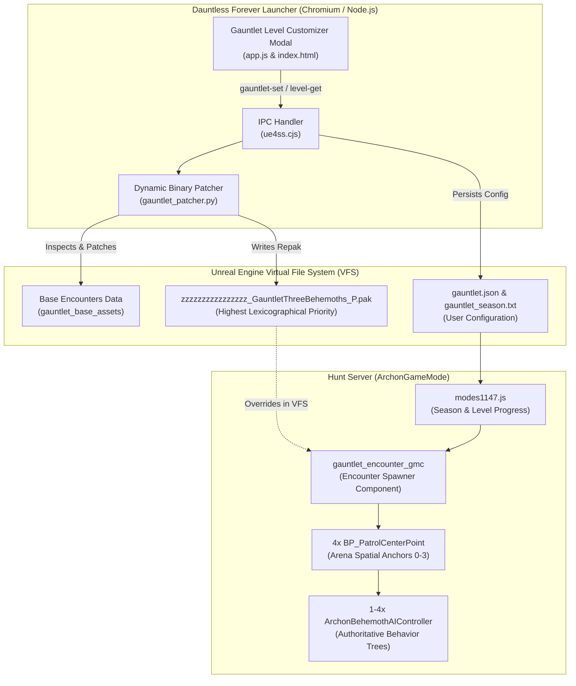
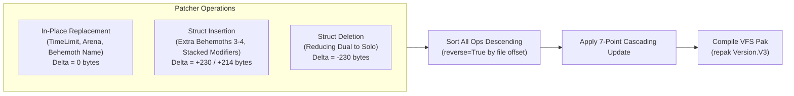
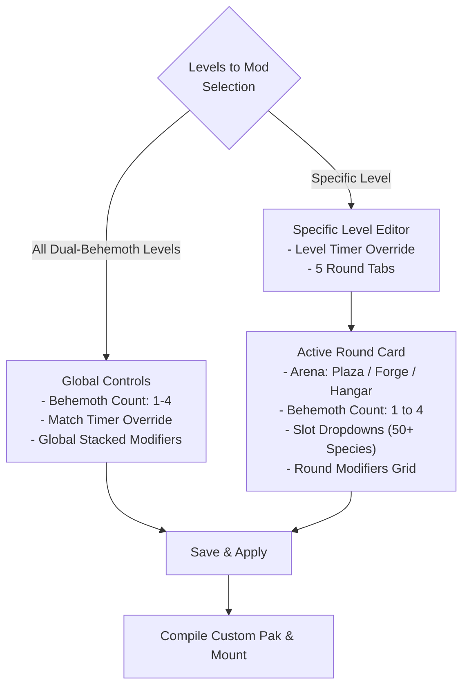

# Gauntlet Mode Customizer & Multi-Behemoth Spawner: Technical Architecture

## 1. Overview & System Context

In Dauntless 1.14.7 (under the Dauntless Forever offline architecture), the game operates as a local client-server pair:
* **Hunt Server (`ArchonServer` / `ArchonGameMode`)**: A dedicated background process that simulates world physics, combat resolution, monster AI state machines, and encounter orchestration.
* **Slayer Client (`Dauntless-Win64-Shipping.exe`)**: Renders graphics, captures player input, and receives replicated actor states from the local hunt server.

In **Gauntlet Mode**, players traverse levels (1 through 20+), each consisting of 5 consecutive rounds. In the vanilla game, higher-tier rounds featured dual-behemoth encounters locked to specific seasons. This system expands Gauntlet Mode into a fully modular customizer:
1. **Dynamic Behemoth Density**: Scales any round between 1 (Solo), 2 (Dual), 3 (Trio), and 4 (Brawl) simultaneous Behemoths.
2. **Season Switching**: Toggles the active encounter tables across Seasons 1, 2, 3, 4, and 5.
3. **Specific Level Customization**: Customizes any level's starting match timer, each round's arena, behemoth slots (from 50+ species), and stacked hunt modifiers.
4. **All-Level Unlocking**: Unlocks levels 1 to 100 on the hunt board for all seasons.



---

## 2. Spawner Architecture & Spatial Anchors

### 2.1 The Native Encounter Spawner (`gauntlet_encounter_gmc`)
Gauntlet round progression is controlled by `gauntlet_encounter_gmc` (a specialized Game Mode Component attached to `ArchonGameMode`). 

When a Gauntlet hunt begins on the arena island (`adventure_destroyed_ramsgate_00`):
1. `gauntlet_encounter_gmc` reads the encounter data table matching the active season (`gauntlet_mode_encounter_specs[_s2..s5].uasset`).
2. It fetches the row matching the current Level (e.g. `GAUNTLET_S1_LEVEL_5`) and extracts the `RoundStructures` array.
3. For each round, it iterates through the `Content` array composed of `GauntletModeRoundContent` structs:
   ```cpp
   for (const FGauntletModeRoundContent& Item : CurrentRound.Content)
   {
       if (Item.ContentType == EGauntletContentType::Behemoth)
       {
           SpawnBehemothAtChallengeLevelAtPatrolPoint(
               Item.BehemothName, 
               CurrentChallengeLevel, 
               PatrolPointIndex++
           );
       }
       else if (Item.ContentType == EGauntletContentType::Modifier)
       {
           ApplyRoundModifier(Item.Modifier, Item.ModifierMagnitude);
       }
   }
   ```

### 2.2 Spatial Anchor Allocation
The arena level contains 4 pre-placed spatial anchors of type `BP_PatrolCenterPoint`:
* `BP_PatrolCenterPoint_0`: Center-Left quadrant
* `BP_PatrolCenterPoint_1`: Center-Right quadrant
* `BP_PatrolCenterPoint_2`: Far-Center quadrant
* `BP_PatrolCenterPoint_3`: Central altar / reserve point

Vanilla dual encounters only contained 2 Behemoth entries in the `Content` array, leaving anchors 2 and 3 idle. By inserting 3rd and 4th struct entries into the `Content` array, the spawner loop naturally advances `PatrolPointIndex` to `2` and `3`, anchoring up to 4 Behemoths simultaneously with full pathfinding and combat AI.

---

## 3. Gauntlet Seasons Architecture

### 3.1 Encounter Specification Data Tables
Each season defines unique level progressions, arenas, Behemoth compositions, and tier difficulties stored in cooked `.uasset` / `.uexp` files:

| Season | Asset File Base Name | Total Defined Levels |
| :--- | :--- | :--- |
| **Season 1** | `gauntlet_mode_encounter_specs` | Levels 1 to 20 (Loops thereafter) |
| **Season 2** | `gauntlet_mode_encounter_specs_s2` | Levels 1 to 20 (Loops thereafter) |
| **Season 3** | `gauntlet_mode_encounter_specs_s3` | Levels 1 to 20 (Loops thereafter) |
| **Season 4** | `gauntlet_mode_encounter_specs_s4` | Levels 1 to 16 (Loops thereafter) |
| **Season 5** | `gauntlet_mode_encounter_specs_s5` | Levels 1 to 16 (Loops thereafter) |

### 3.2 Active Season Switching
In vanilla Dauntless, the active season was hardcoded by server backend responses. In Dauntless Forever:
1. When a player selects a Season in the launcher modal, `gauntletSet` writes the selected season number to `data/gauntlet_season.txt`.
2. The offline metagame server (`backend/modes1147.js`) reads `data/gauntlet_season.txt` during initialization and assigns the active Gauntlet season dynamically.
3. The launcher UI reads `data/gauntlet_season.txt` to dynamically tag the current season in dropdowns with `(Active / Current)`.

### 3.3 All-Level Unlock Architecture
Gauntlet level completion is tracked per season in `data/state.json`:
```json
"mega1147": {
  "gauntlet1147": {
    "gauntlet-season1": { "completed": [1, 2, ..., 100], "highest": 100 },
    "gauntlet-season2": { "completed": [1, 2, ..., 100], "highest": 100 },
    "gauntlet-season3": { "completed": [1, 2, ..., 100], "highest": 100 },
    "gauntlet-season4": { "completed": [1, 2, ..., 100], "highest": 100 },
    "gauntlet-season5": { "completed": [1, 2, ..., 100], "highest": 100 }
  }
}
```
The "Unlock All Levels (1-100)" action populates the player's completion table for the target season (or all 5 seasons simultaneously), providing instant board access to any level.

---

## 4. Binary Layout of Level & Round Structs

Cooked Unreal Engine 4.26 assets split data across `.uasset` (header and Name Map) and `.uexp` (serialized tagged property payload).

### 4.1 Level Struct Properties (`GAUNTLET_S1_LEVEL_X`)
Each level row in `.uexp` contains:
* **`Level`** (`IntProperty`): The numerical level ID.
* **`TimeLimit`** (`FloatProperty`): Starting match timer in seconds (vanilla default: `420.0` = 07:00).
* **`RoundStructures`** (`ArrayProperty`): An array of exactly 5 round structures.
* **`StateTimings`** (`StructProperty`): Timing intervals for announcements, transitions, and summaries.

### 4.2 Round Struct Properties
Inside each element of `RoundStructures`:
* **`Arena`** (`EnumProperty`): Specifies the arena layout. Stores an `FName` index to one of three valid enums:
  * `EGauntletArena::Plaza` (Central ruins)
  * `EGauntletArena::Forge` (Molten core)
  * `EGauntletArena::Hangar` (Aetheric platforms)
* **`Content`** (`ArrayProperty`): An array of `GauntletModeRoundContent` structs containing the round's Behemoths and hunt modifiers.

### 4.3 `GauntletModeRoundContent` Binary Layout

#### Behemoth Entry (230 bytes / 0xE6)
```
[Offset +0x00] Tag "ContentType" (ByteProperty, enum "EGauntletContentType::Behemoth") = 0x01
[Offset +0x3A] Tag "BehemothName" (NameProperty)
               +0x42: FName Index (uint32) -> Points to monster ID (e.g. "crowbear_alpha")
               +0x46: FName Number (uint32) -> 0
[Offset +0x4A] Tag "ChallengeLevelDelta" (IntProperty)
[Offset +0x72] Tag "Modifiers" (ArrayProperty of GameplayTags)
[Offset +0xC0] Tag "ScaleFactor" (FloatProperty)
[Offset +0xE0] Tag "None" (8 bytes: 00 00 00 00 00 00 00 00)
```

#### Hunt Modifier Entry (214 bytes / 0xD6)
```
[Offset +0x00] Tag "ContentType" (ByteProperty, enum "EGauntletContentType::Modifier") = 0x02
[Offset +0x3A] Tag "Modifier" (StructProperty, struct "GauntletRoundModifier")
               ... Tag "RowName" (NameProperty)
               +0xCE: FName Index (uint32) -> Points to modifier ID (e.g. "HM_ELECTRIFY")
[Offset +0xD0] Tag "None" (8 bytes: 00 00 00 00 00 00 00 00)
```

---

## 5. Dynamic Binary Patcher (`gauntlet_patcher.py`)

The patcher operates directly on base game encounter assets (`tools/gauntlet_base_assets/`) and outputs a compiled `.pak`.



### 5.1 Dynamic Level Struct Inspector (`inspect_level`)
The CLI subcommand `python gauntlet_patcher.py inspect <season> <level>` deserializes the target level's `.uexp` data:
1. Resolves `GAUNTLET_S1_LEVEL` row offset.
2. Extracts `TimeLimit` float.
3. Iterates over all 5 rounds, extracting each round's `Arena`, Behemoth species list, and `Modifiers`.
4. Gathers all Behemoth species present in that season's `.uasset` Name Table, pairing them with human-readable display names (e.g. `Bloodshot Shrowd (crowbear_alpha)`, `Torgadoro (armstrong_normal)`, `Flameborn Rezakiri (paper_heroic)`).
5. Emits structured JSON consumed directly by the launcher UI via IPC.

### 5.2 The 7-Point Cascading Offset Update
When structs are inserted or deleted, the payload size of containing tags, array lengths, and `.uasset` export headers must be adjusted simultaneously:

1. **`Content` Tag Payload Size**: Offset `+0x10` of `Content` tag (`uint32` $\pm \text{delta}$).
2. **`Content` Item Count**: First 4 bytes of `Content` raw payload (`uint32` $\pm 1$).
3. **`Content` Inner Struct Size**: Offset `+0x14` of `Content` raw payload (`uint64` $\pm \text{delta}$).
4. **`RoundStructures` Tag Payload Size**: Offset `+0x10` of `RoundStructures` tag (`uint32` $\pm \text{delta}$).
5. **`RoundStructures` Inner Struct Size**: Offset `+0x14` of `RoundStructures` raw payload (`uint64` $\pm \text{delta}$).
6. **Export Table `SerialSize`**: `.uasset` export descriptor at `export_at + 28` (`int64` $\pm \text{delta}$).
7. **Bulk Offset**: `.uasset` header field at byte offset `169` (`int64` $\pm \text{delta}$).

> [!IMPORTANT]
> **Reverse-Order Offset Invariance**:
> Inserting or deleting bytes alters the absolute offsets of all subsequent data. By sorting all scheduled patch operations in **descending order of file offset** (`reverse=True`), modifications at the end of the file never invalidate the target offsets of operations closer to the beginning.

### 5.3 Behemoth Slot Operations
* **In-Place Substitution**: When replacing an existing Behemoth slot with a new species, the patcher writes the new `FName` index directly into `BehemothName` tag raw offset. File size delta is exactly `0`.
* **Expansion (3-4 Behemoths)**: When scaling above existing slots, a 230-byte template struct is cloned, its `BehemothName` index is rewritten, and the struct is inserted with a $+230$ byte cascading delta.
* **Reduction (1 Solo Behemoth)**: When reducing a dual round down to 1 Behemoth, the redundant struct slice is removed with a $-230$ byte cascading delta.

---

## 6. Launcher UI Integration

### 6.1 Modal Architecture (`dlg-gauntlet`)
The launcher interface (`src/renderer/index.html` and `src/renderer/app.js`) provides two distinct configuration modes:

#### Global Dual-Behemoth Mode (`allDualBehemothLevels: true`)
Applies macro-level tuning across all dual-behemoth encounters in the selected season:
* **Behemoths per Dual-Round**: `1 Solo`, `2 Dual`, `3 Trio (Mod)`, `4 Brawl`.
* **Global Match Timer**: Override starting timer (`07:00`, `03:00`, `05:00`, `10:00`, `15:00`).
* **Hunt Modifiers Grid**: Stacks multiple hunt modifiers (e.g., *Push and Pull*, *Electrify*, *Combustion*, *Stonehide*, *Weak Spot Surge*) across all qualifying rounds.

#### Specific Level Customizer (`allDualBehemothLevels: false`)
When "Specific Level (e.g. Level 5)" is chosen:
1. The UI invokes `gauntlet-level-get` to inspect the level's actual binary struct.
2. Displays the level's specific **Starting Match Timer**.
3. Renders 5 **Round Navigation Tabs** (`[ Round 1 ]` to `[ Round 5 ]`).
4. For the selected round, provides:
   * **Arena Dropdown**: Plaza, Forge, or Hangar.
   * **Round Behemoth Count**: Interactive pills (1 to 4).
   * **Behemoth Slot Dropdowns**: Dynamically renders 1 to 4 dropdowns populated with all valid Behemoths for that season.
   * **Round Modifiers**: Checkboxes for hunt modifiers applied specifically to that round.
5. User edits are cached across round tabs and saved into `levelConfig` in `data/gauntlet.json`.



### 6.2 IPC Communication Protocol (`ue4ss.cjs`)
The launcher communicates with the backend toolchain via asynchronous IPC:
* `gauntlet-get`: Fetches active season, saved configuration, and available modifiers.
* `gauntlet-level-get <season> <level>`: Deserializes and returns struct data and species catalogs for a specific level.
* `gauntlet-set <base64_json>`: Receives configuration payload, writes `data/gauntlet.json` and `data/gauntlet_season.txt`, runs `gauntlet_patcher.py`, and mounts the resulting `.pak`.
* `gauntlet-unlock-all`: Unlocks levels 1 to 100 in `data/state.json`.

All inter-process payloads are base64-encoded to guarantee cross-platform string safety without shell escaping issues.

---

## 7. Virtual File System (VFS) Packaging & Pak Precedence

Patched encounter assets are compiled into an Unreal Engine package file using `repak`:

```python
builder = repak.PakBuilder()
writer = builder.writer(
    'zzzzzzzzzzzzzzzz_GauntletThreeBehemoths_P.pak',
    version=repak.Version.V3,
    mount_point='../../../'
)
```

### 7.1 Mount Point Relative Addressing (`../../../`)
* Game binary location: `<GameRoot>/Archon/Binaries/Win64/Dauntless-Win64-Shipping.exe`
* Engine content root: `<GameRoot>/Archon/Content/`
* Specifying a mount point of `../../../` aligns the pak archive root directly with `<GameRoot>/`. Paths inside the pak (e.g., `Archon/Content/gamemodes/escalation/base_blueprints/gauntlet_mode_encounter_specs.uasset`) map directly over the base game assets in VFS.

### 7.2 Lexicographical Precedence
Unreal Engine loads patch paks (`*_P.pak`) in strict alphabetical order:
1. Paks ending in `_P.pak` supersede non-patch paks.
2. By prefixing the pak filename with `zzzzzzzzzzzzzzzz_`, the custom pak mounts last in the VFS queue, overriding vanilla encounter tables with 100% authority.
3. Toggling the mod OFF in the launcher simply renames the file to `.pak.off`, instantly restoring vanilla gameplay without asset redownloads.

---

## 8. Summary Specification Table

| System Component | Technology / Mechanism | Implementation Details |
| :--- | :--- | :--- |
| **Encounter Orchestration** | Unreal Engine C++ / GMC | `gauntlet_encounter_gmc` spawns actors per `Content` entry at `BP_PatrolCenterPoint` [0..3] |
| **Season Selection** | Metagame Server (`modes1147.js`) | Reads active season from `data/gauntlet_season.txt`; switches encounter table between S1–S5 |
| **Board Progression** | Local State JSON (`state.json`) | Unlocks levels 1–100 across seasons in `mega1147.gauntlet1147` |
| **Binary Formats** | Cooked UE 4.26/4.27 UAsset & UExp | Tagged properties; 230-byte Behemoth structs and 214-byte Modifier structs |
| **Binary Patcher** | Python (`gauntlet_patcher.py`) | Inspects structs; applies in-place edits, expansions (up to 4), and shrink deletions |
| **Offset Synchronization** | Cascading Size Recalculation | 7-point updates across Tag Size, Array Count, Struct Inner Size, Export SerialSize, and Bulk Offset |
| **Patch Sequencing** | Reverse-Order Execution | Operations applied in descending order of file offset (`reverse=True`) to maintain offset invariance |
| **VFS Packaging** | `repak` (Version V3) | `zzzzzzzzzzzzzzzz_GauntletThreeBehemoths_P.pak` mounted at `../../../` for top override priority |
| **IPC Bridge** | Node.js (`ue4ss.cjs` / `main.js`) | Actions `gauntlet-get`, `gauntlet-set`, `gauntlet-level-get`, `gauntlet-unlock-all` via Base64 JSON |
| **Launcher Interface** | HTML5 / CSS3 / Vanilla JS | Dual-mode modal: Global Dual-Round tuning vs. Specific Level 5-Round struct customizer |
| **Encoding Integrity** | 7-bit ASCII Check (`check-ascii.js`) | All launcher code, templates, and scripts strictly verified for clean ASCII compliance |
