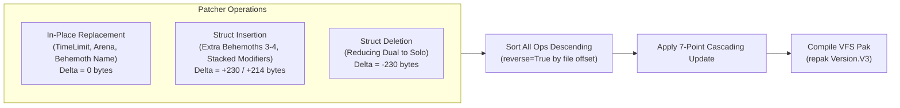
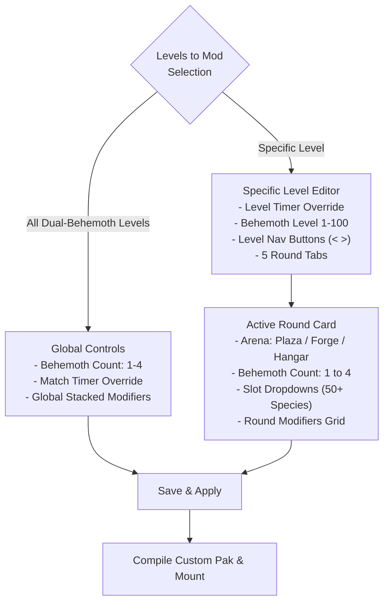

# Gauntlet Mode Customizer & Multi-Behemoth Spawner: Technical Architecture

## 1. Overview & System Context

In Dauntless 1.14.7 (under the Dauntless Forever offline architecture), the game operates as a local client-server pair:
* **Hunt Server (`ArchonServer` / `ArchonGameMode`)**: A dedicated background process that simulates world physics, combat resolution, monster AI state machines, and encounter orchestration.
* **Slayer Client (`Dauntless-Win64-Shipping.exe`)**: Renders graphics, captures player input, and receives replicated actor states from the local hunt server.

In **Gauntlet Mode**, players traverse levels (1 through 20+), each consisting of 5 consecutive rounds. In the vanilla game, higher-tier rounds featured dual-behemoth encounters locked to specific seasons. This system expands Gauntlet Mode into a fully modular customizer:
1. **Dynamic Behemoth Density**: Scales any round between 1 (Solo), 2 (Dual), 3 (Trio), and 4 (Brawl) simultaneous Behemoths.
2. **Season Switching**: Toggles the active encounter tables across Seasons 1, 2, 3, 4, and 5.
3. **Specific Level Customization**: Customizes any level's starting match timer, each round's arena, behemoth slots (from 50+ species), stacked hunt modifiers, and per-level **Behemoth Level** (1 to 100).
4. **Dynamic Row Expansion**: Scales up to 1000 unique levels per season natively without engine looping.
5. **Native Behemoth Level Scaling Table**: Expands `exploration_enemy_level_table` from Level 25 up to Level 100 with accurate Name Map hashing and damage curves.
6. **All-Level Unlocking & Hunt Board Pagination**: Unlocks levels 1 to 1000 on the hunt board across 100-level chunks.
7. **Procedural Season Generator**: Generates full custom seasons with elemental themes, milestone boss levels, and customizable behemoth level progression.
8. **Large-Payload Streaming Architecture**: Employs `@filepath` CLI streaming to bypass OS command-line limits when compiling massive multi-level seasons.

```mermaid
flowchart TD
    subgraph Launcher ["Dauntless Forever Launcher (Chromium / Node.js)"]
        UI["Gauntlet Level Customizer Modal\n(app.js & index.html)"]
        IPC["IPC Handler\n(ue4ss.cjs & main.js)"]
        Patcher["Dynamic Binary Patcher\n(gauntlet_patcher.py)"]
    end

    subgraph Storage ["Unreal Engine Virtual File System (VFS)"]
        BaseEncounters["Base Encounter Specs\n(gauntlet_base_assets)"]
        BaseLevelTable["Base Enemy Level Table\n(exploration_enemy_level_table)"]
        Pak["zzzzzzzzzzzzzzzz_GauntletThreeBehemoths_P.pak\n(Highest Lexicographical Priority)"]
        Config["gauntlet.json & gauntlet_season.txt\n(User Configuration)"]
    end

    subgraph Server ["Hunt Server (ArchonGameMode)"]
        Meta["modes1147.js\n(Season & Level Progress)"]
        GMC["gauntlet_encounter_gmc\n(Encounter Spawner Component)"]
        Patrol["4x BP_PatrolCenterPoint\n(Arena Spatial Anchors 0-3)"]
        AI["1-4x ArchonBehemothAIController\n(Authoritative Behavior Trees)"]
    end

    UI -->|gauntlet-set / level-get\n(@filepath streaming)| IPC
    IPC --> Patcher
    Patcher -->|Inspects & Patches Specs| BaseEncounters
    Patcher -->|Compiles Rows 0..100| BaseLevelTable
    Patcher -->|Writes Repak| Pak
    IPC -->|Persists Config| Config
    Config --> Meta
    Pak -.->|Overrides in VFS| GMC
    Meta --> GMC
    GMC --> Patrol
    Patrol --> AI
```

---

## 2. Spawner Architecture & Spatial Anchors

### 2.1 The Native Encounter Spawner (`gauntlet_encounter_gmc`)
Gauntlet round progression is controlled by `gauntlet_encounter_gmc` (a specialized Game Mode Component attached to `ArchonGameMode`). 

When a Gauntlet hunt begins on the arena island (`adventure_destroyed_ramsgate_00`):
1. `gauntlet_encounter_gmc` reads the encounter data table matching the active season (`gauntlet_mode_encounter_specs[_s2..s5].uasset`).
2. It fetches the row matching the current Level (e.g. `GAUNTLET_S1_LEVEL_5`) and extracts the `RoundStructures` array.
3. For each round, it iterates through the `Content` array composed of `GauntletModeRoundContent` structs:
   ```cpp
   for (const FGauntletModeRoundContent& Item : CurrentRound.Content)
   {
       if (Item.ContentType == EGauntletContentType::Behemoth)
       {
           SpawnBehemothAtChallengeLevelAtPatrolPoint(
               Item.BehemothName, 
               CurrentChallengeLevel, 
               PatrolPointIndex++
           );
       }
       else if (Item.ContentType == EGauntletContentType::Modifier)
       {
           ApplyRoundModifier(Item.Modifier, Item.ModifierMagnitude);
       }
   }
   ```

### 2.2 Spatial Anchor Allocation
The arena level contains 4 pre-placed spatial anchors of type `BP_PatrolCenterPoint`:
* `BP_PatrolCenterPoint_0`: Center-Left quadrant
* `BP_PatrolCenterPoint_1`: Center-Right quadrant
* `BP_PatrolCenterPoint_2`: Far-Center quadrant
* `BP_PatrolCenterPoint_3`: Central altar / reserve point

Vanilla dual encounters only contained 2 Behemoth entries in the `Content` array, leaving anchors 2 and 3 idle. By inserting 3rd and 4th struct entries into the `Content` array, the spawner loop naturally advances `PatrolPointIndex` to `2` and `3`, anchoring up to 4 Behemoths simultaneously with full pathfinding and combat AI.

---

## 3. Gauntlet Seasons Architecture

### 3.1 Encounter Specification Data Tables
Each season defines unique level progressions, arenas, Behemoth compositions, and tier difficulties stored in cooked `.uasset` / `.uexp` files:

| Season | Asset File Base Name | Vanilla Defined Levels | Custom Generator Max |
| :--- | :--- | :--- | :--- |
| **Season 1** | `gauntlet_mode_encounter_specs` | Levels 1 to 20 (Vanilla Loops) | Up to 1000 Unique Levels |
| **Season 2** | `gauntlet_mode_encounter_specs_s2` | Levels 1 to 20 (Vanilla Loops) | Up to 1000 Unique Levels |
| **Season 3** | `gauntlet_mode_encounter_specs_s3` | Levels 1 to 20 (Vanilla Loops) | Up to 1000 Unique Levels |
| **Season 4** | `gauntlet_mode_encounter_specs_s4` | Levels 1 to 16 (Vanilla Loops) | Up to 1000 Unique Levels |
| **Season 5** | `gauntlet_mode_encounter_specs_s5` | Levels 1 to 16 (Vanilla Loops) | Up to 1000 Unique Levels |

### 3.2 Dynamic Row Expansion (Up to 1000 Unique Levels)
In vanilla Dauntless, encounter specification tables contain only 16 or 20 rows (`GAUNTLET_S1_LEVEL_1` through `_20`). When slayers reached level 21+, the engine looped back using `(Level - 1) % RowCount + 1` with scaled stats from `gauntlet_mode_tuning_specs`.

The Gauntlet Customizer removes this hard cap entirely:
1. **Dynamic UDataTable Row Duplication**: When generating or configuring levels beyond the base count (e.g. 50, 100, 200, 500, or up to 1000 levels), `gauntlet_patcher.py` clones the binary row specification struct, sets the new `FName` index and number (`LevelNumber + 1`), and appends the new unique rows directly into the table before the package footer.
2. **DataTable Header & Export Synchronization**: The total row count integer at byte 67 of the `.uexp` file is updated to the new level total, and the UAsset export `SerialSize` and bulk data offsets are adjusted accordingly.
3. **Native Engine Discovery**: When Unreal Engine initializes the encounter table, `RowMap` populates all unique levels natively (e.g. up to 1000), loading bespoke behemoth rosters, arenas, and modifiers for every single level without looping!
4. **Hunt Board Pagination Integration**: The in-game hunt board organizes levels into 100-level chunks (`1-100`, `101-200`, ..., `801-900`, `901-1000`). When unlocking all levels, `modes1147.js` and `ue4ss.cjs` read the highest level configured in `gauntlet.json` and set player progression accordingly so every chunk becomes available on the hunt board.
5. **Elemental Themes & Boss Milestones**: The procedural season generator supports elemental themes (Frostfall, Inferno, Shock Surge, Terra Dominion, Umbral Void, Radiant Dawn, Keystone Boss Rush) and boss milestones (mini-bosses and keystone encounters every 5 or 10 levels).

### 3.3 Enemy Level Scaling Architecture (`exploration_enemy_level_table` up to Level 100)
In vanilla Dauntless, the encounter tables dictate the numerical `BehemothLevel` for each encounter, but the monster level scaling curves and reward tables were defined in `/Game/Monsters/_shared/data_tables/exploration_enemy_level_table`.

> [!CAUTION]
> **The Vanilla Level 26+ Null Row Problem**:
> In vanilla Dauntless, `exploration_enemy_level_table` only defined rows `0` through `25`. When an encounter requested Behemoth Level 26 or higher, the engine called `GetDataTableRowFromName` with the level string (e.g. `"26"`, `"30"`). Because rows above 25 did not exist, the lookup returned `nullptr`. This caused `SpawnBehemothAtChallengeLevelAtPatrolPoint` to fail silently, resulting in an empty arena where no Behemoths spawned!

To allow arbitrary Behemoth Level tuning up to Level 100:
1. **Name Map Extension via CityHash64**: The patcher reads `digit_name_hashes.json` (containing pre-computed UE4 case-preserving and non-case-preserving Name Map hashes for strings `"0"` through `"100"`). It appends missing digit names `"26"` through `"100"` to the `.uasset` Name Map, shifting import, export, and dependency offsets accordingly.
2. **DataTable Row Synthesis**: The `.uexp` row count at byte 41 is updated to `101` (representing levels 0 to 100). The row struct from Level 25 is cloned and parameterized for levels 26 to 100:
   * **Row Name FName**: Pointed to the new name entry (`s_idx`).
   * **Rams Reward** (offset 414): Scaled as `min(2000, 500 + (lvl - 25) * 10)`.
   * **Mastery XP Reward** (offset 777): Scaled as `100 + (lvl - 1) * 10`.
   * **Recommended Slayer Power** (offsets 806 & 835): Scaled as `65 + (lvl - 1) * 25`.
3. **VFS Packaging**: The expanded `exploration_enemy_level_table.uasset` and `.uexp` are bundled directly into `zzzzzzzzzzzzzzzz_GauntletThreeBehemoths_P.pak` under `Archon/Content/Monsters/_shared/data_tables/`.
4. **Gameplay Outcome**: Slayers can face Behemoths scaling smoothly from standard tier (Level 10) up through Endgame (Level 25), Nightmare (Level 30), Torment (Level 40), Mythic (Level 50), and beyond (up to Level 100) with complete combat power curve evaluation, dynamic damage calculations, and functional Mastery rewards.

### 3.4 Active Season Switching
In vanilla Dauntless, the active season was hardcoded by server backend responses. In Dauntless Forever:
1. When a player selects a Season in the launcher modal, `gauntletSet` writes the selected season number to `data/gauntlet_season.txt`.
2. The offline metagame server (`backend/modes1147.js`) reads `data/gauntlet_season.txt` during initialization and assigns the active Gauntlet season dynamically.
3. The launcher UI reads `data/gauntlet_season.txt` to dynamically tag the current season in dropdowns with `(Active / Current)`.

### 3.5 All-Level Unlock & Hunt Board Pagination Architecture
Gauntlet level completion is tracked per season in `data/state.json`:
```json
"mega1147": {
  "gauntlet1147": {
    "gauntlet-season1": { "completed": [1, 2, ..., 100], "highest": 100 },
    "gauntlet-season2": { "completed": [1, 2, ..., 100], "highest": 100 },
    "gauntlet-season3": { "completed": [1, 2, ..., 100], "highest": 100 },
    "gauntlet-season4": { "completed": [1, 2, ..., 100], "highest": 100 },
    "gauntlet-season5": { "completed": [1, 2, ..., 100], "highest": 100 }
  }
}
```

The unlock system dynamically inspects the active season configuration in `gauntlet.json`:
1. `modes1147.js` (`getUnlockTargetCount`) and `ue4ss.cjs` (`unlockGauntletLevels`) inspect `levelConfig` keys and `targetLevels` to determine the maximum level configured (clamped to a minimum of 100 and up to 1000).
2. The player's completed levels array `completed` is populated with `[1, 2, ..., maxLvl]` and `highest` is set to `maxLvl`.
3. In-game, the Hunt Board's Gauntlet tab paginates levels into 100-level chunks (`1-100`, `101-200`, ..., `901-1000`). With `highest` set to the maximum configured level, every 100-level page is unlocked and immediately selectable.

---

## 4. Binary Layout of Level & Round Structs

Cooked Unreal Engine 4.26 assets split data across `.uasset` (header and Name Map) and `.uexp` (serialized tagged property payload).

### 4.1 Level Struct Properties (`GAUNTLET_S1_LEVEL_X`)
Each level row in `.uexp` contains:
* **`Level`** (`IntProperty`): The numerical level ID.
* **`TimeLimit`** (`FloatProperty`): Starting match timer in seconds (vanilla default: `420.0` = 07:00).
* **`BehemothLevel`** (`IntProperty`): Numerical monster level rating (offset +99 in level row struct). Directly dictates monster base combat stats, health, damage, and the in-game hunt board "Average Behemoth Level: X" display. Scaled up to Level 100 with the expanded level table.
* **`RoundStructures`** (`ArrayProperty`): An array of exactly 5 round structures.
* **`StateTimings`** (`StructProperty`): Timing intervals for announcements, transitions, and summaries.

### 4.2 Round Struct Properties
Inside each element of `RoundStructures`:
* **`Arena`** (`EnumProperty`): Specifies the arena layout. Stores an `FName` index to one of three valid enums:
  * `EGauntletArena::Plaza` (Central ruins)
  * `EGauntletArena::Forge` (Molten core)
  * `EGauntletArena::Hangar` (Aetheric platforms)
* **`Content`** (`ArrayProperty`): An array of `GauntletModeRoundContent` structs containing the round's Behemoths and hunt modifiers.

### 4.3 `GauntletModeRoundContent` Binary Layout

#### Behemoth Entry (230 bytes / 0xE6)
```
[Offset +0x00] Tag "ContentType" (ByteProperty, enum "EGauntletContentType::Behemoth") = 0x01
[Offset +0x3A] Tag "BehemothName" (NameProperty)
               +0x42: FName Index (uint32) -> Points to monster ID (e.g. "crowbear_alpha")
               +0x46: FName Number (uint32) -> 0
[Offset +0x4A] Tag "ChallengeLevelDelta" (IntProperty)
[Offset +0x72] Tag "Modifiers" (ArrayProperty of GameplayTags)
[Offset +0xC0] Tag "ScaleFactor" (FloatProperty)
[Offset +0xE0] Tag "None" (8 bytes: 00 00 00 00 00 00 00 00)
```

#### Hunt Modifier Entry (214 bytes / 0xD6)
```
[Offset +0x00] Tag "ContentType" (ByteProperty, enum "EGauntletContentType::Modifier") = 0x02
[Offset +0x3A] Tag "Modifier" (StructProperty, struct "GauntletRoundModifier")
               ... Tag "RowName" (NameProperty)
               +0xCE: FName Index (uint32) -> Points to modifier ID (e.g. "HM_ELECTRIFY")
[Offset +0xD0] Tag "None" (8 bytes: 00 00 00 00 00 00 00 00)
```

---

## 5. Dynamic Binary Patcher (`gauntlet_patcher.py`)

The patcher operates directly on base game encounter assets (`tools/gauntlet_base_assets/`) and outputs a compiled `.pak`.



### 5.1 Dynamic Level Struct Inspector (`inspect_level`)
The CLI subcommand `python gauntlet_patcher.py inspect <season> <level>` deserializes the target level's `.uexp` data:
1. Resolves `GAUNTLET_S1_LEVEL` row offset.
2. Extracts `TimeLimit` float.
3. Iterates over all 5 rounds, extracting each round's `Arena`, Behemoth species list, and `Modifiers`.
4. Gathers all Behemoth species present in that season's `.uasset` Name Table, pairing them with human-readable display names (e.g. `Bloodshot Shrowd (crowbear_alpha)`, `Heroic Torgadoro (armstrong_heroic)`, `Flameborn Rezakiri (bugbear_blaze)`, `Heroic Koshai (paper_heroic)`).
5. Emits structured JSON consumed directly by the launcher UI via IPC.

### 5.2 The 7-Point Cascading Offset Update
When structs are inserted, removed, or resized, the payload size of containing tags, array lengths, and `.uasset` export headers are adjusted simultaneously:

1. **`Content` Tag Payload Size**: Offset `+0x10` of `Content` tag (`uint32` $\pm \text{delta}$).
2. **`Content` Item Count**: First 4 bytes of `Content` raw payload (`uint32` new count).
3. **`Content` Inner Struct Size**: Offset `+0x14` of `Content` raw payload (`uint64` $\pm \text{delta}$).
4. **`RoundStructures` Tag Payload Size**: Offset `+0x10` of `RoundStructures` tag (`uint32` $\pm \text{delta}$).
5. **`RoundStructures` Inner Struct Size**: Offset `+0x14` of `RoundStructures` raw payload (`uint64` $\pm \text{delta}$).
6. **Export Table `SerialSize`**: `.uasset` export descriptor at `export_at + 28` (`int64` $\pm \text{delta}$).
7. **Bulk Offset**: `.uasset` header field at byte offset `169` (`int64` $\pm \text{delta}$).

> [!IMPORTANT]
> **Reverse-Order Offset Invariance**:
> Altering byte slice sizes modifies the absolute offsets of all subsequent file positions. By sorting all scheduled patch operations in **descending order of file offset** (`reverse=True`), modifications at the end of the file never invalidate target offsets closer to the beginning.

### 5.3 Behemoth & Modifier Slot Operations
Every entry in a round's `Content` array is a 230-byte `GauntletModeRoundContent` struct:
* **Behemoth Entry**: `ContentType = EGauntletContentType::Behemoth` (offset 33), `BehemothName` (offset 66), and `Modifier.RowName = None` (offset 206).
* **Hunt Modifier Entry**: `ContentType = EGauntletContentType::Modifier` (offset 33), `BehemothName = None` (offset 66), `BehemothLevel = 0` (offset 99), and `Modifier.RowName` pointing to the modifier FName (offset 206).
* **Round Rebuilding**: Each round constructs its desired slice of Behemoth and Modifier structs. When the new payload differs from vanilla, the entire item slice is replaced in one clean operation, ensuring modifiers can be added to rounds with zero vanilla modifiers, updated, or removed cleanly.

### 5.4 Binary Synthesis of `exploration_enemy_level_table` (`build_expanded_enemy_level_table`)
To allow Behemoths to spawn natively above level 25 without engine `nullptr` crashes, `gauntlet_patcher.py` generates an expanded binary table covering levels 0 through 100:

1. **Name Map Extension via `digit_name_hashes.json`**:
   Cooked Unreal Engine 4 `FName` entries in `.uasset` headers store two 16-bit hashes (non-case-preserving and case-preserving hashes):
   ```python
   new_name_entries.extend(
       struct.pack('<i', slen) + s_bytes + struct.pack('<HH', h1, h2)
   )
   ```
   The pre-calculated hash file `digit_name_hashes.json` maps digits `"0"` to `"100"` to their exact CityHash64 / UE4 Name Map hash values. When expanding the table, entries for `"26"` through `"100"` are serialized and appended to the Name Map.

2. **Header & Offset Relocation**:
   Adding new strings alters the starting positions of all subsequent asset tables. The synthesizer recalculates and patches 8 distinct `.uasset` header offsets:
   * **Total File Size** (offset 24): `total_new_uasset_size`
   * **Name Count** (offsets 41 & 117): `len(names_list)`
   * **Import Offset** (offset 69): Shifted by `name_delta`
   * **Export Offset** (offset 61): Shifted by `name_delta`
   * **Dependency Offset** (offset 73): Shifted by `name_delta`
   * **Asset Registry Data Offset** (offset 165): Shifted by `name_delta`
   * **Preload Dependency Offset** (offset 189): Shifted by `name_delta`
   * **Bulk Data Start Offset** (offset 169): Updated to `total_uasset_size + total_uexp_size - 4`

3. **DataTable Row Synthesis in `.uexp`**:
   * Total row count at offset 41 is set to `max_level + 1` (`101` for level 100).
   * Level 25's 847-byte row slice is used as an archetype and duplicated for each level from 26 to 100.
   * Row name FName index is pointed to the corresponding digit string in the Name Map.
   * In-game currency reward (offset 414) scales as:
     $$\text{Rams} = \min(2000, 500 + (\text{Level} - 25) \times 10)$$
   * Slayer Mastery XP (offset 777) scales as:
     $$\text{MasteryXP} = 100 + (\text{Level} - 1) \times 10$$
   * Recommended Slayer Power (offsets 806 & 835) scales as:
     $$\text{Power} = 65 + (\text{Level} - 1) \times 25$$

---

## 6. Launcher UI Integration

### 6.1 Modal Architecture (`dlg-gauntlet`)
The launcher interface (`src/renderer/index.html` and `src/renderer/app.js`) provides two distinct configuration modes:

#### Global Dual-Behemoth Mode (`allDualBehemothLevels: true`)
Applies macro-level tuning across all dual-behemoth encounters in the selected season:
* **Behemoths per Dual-Round**: `1 Solo`, `2 Dual`, `3 Trio (Mod)`, `4 Brawl`.
* **Global Match Timer**: Override starting timer (`07:00`, `03:00`, `05:00`, `10:00`, `15:00`).
* **Hunt Modifiers Grid**: Stacks multiple hunt modifiers (e.g., *Push and Pull*, *Electrify*, *Combustion*, *Stonehide*, *Weak Spot Surge*) across all qualifying rounds.

#### Specific Level Customizer (`allDualBehemothLevels: false`)
When "Specific Level (e.g. Level 5)" is chosen:
1. The UI invokes `gauntlet-level-get` to inspect the level's actual binary struct.
2. Provides **Level Number Navigation Controls**: Adjacent `<` (`#gcfg-prev-lvl-btn`) and `>` (`#gcfg-next-lvl-btn`) buttons allow rapid sequential traversal and inspection across levels 1 to 1000 with automatic cache preservation.
3. Displays the level's specific **Starting Match Timer** and **Behemoth Level** (`#gcfg-spec-behemoth-lvl`, editable from 1 to 100).
4. Renders 5 **Round Navigation Tabs** (`[ Round 1 ]` to `[ Round 5 ]`).
5. For the selected round, provides:
   * **Arena Dropdown**: Plaza, Forge, or Hangar.
   * **Round Behemoth Count**: Interactive pills (1 to 4).
   * **Behemoth Slot Dropdowns**: Dynamically renders 1 to 4 dropdowns populated with all valid Behemoths for that season.
   * **Round Modifiers**: Checkboxes for hunt modifiers applied specifically to that round.
6. User edits are cached across round tabs and saved into `levelConfig` in `data/gauntlet.json`.
7. **Window Controls & Layout**: Supports dragging by the title bar, maximize/minimize controls, and responsive grid layout.



### 6.2 IPC Communication Protocol & Large-Payload Streaming
The launcher communicates with the backend toolchain via asynchronous IPC:
* `gauntlet-get`: Fetches active season, saved configuration, and available modifiers.
* `gauntlet-level-get <season> <level>`: Deserializes and returns struct data and species catalogs for a specific level.
* `gauntlet-random-season <season> <options_json>`: Generates procedural custom season configurations with escalating behemoth density, modifiers, and arenas.
* `gauntlet-set <payload>`: Receives configuration payload, writes `data/gauntlet.json` and `data/gauntlet_season.txt`, runs `gauntlet_patcher.py`, and mounts the resulting `.pak`.
* `gauntlet-unlock-all`: Unlocks levels 1 to 1000 in `data/state.json`.

#### Large-Payload Streaming Architecture (`@filepath`)
For custom seasons configuring up to 1000 levels, JSON configurations can reach several megabytes in size, exceeding the Windows `CreateProcess` command-line limit (8,191 characters).
To ensure 100% reliability without truncation:
1. In `src/main/main.js`, `gauntlet-set` writes the configuration directly to `data/gauntlet.json` and invokes `ue4ss.cjs` with an `@filepath` argument (`ue4ss.cjs gauntlet-set @<path/to/gauntlet.json>`). Process execution options are configured with a 10 MB buffer (`maxBuffer: 10 * 1024 * 1024`) and a 120-second timeout.
2. In `ue4ss.cjs`, `gauntletSet()` detects the `@` prefix, reads the payload from disk, and spawns `gauntlet_patcher.py @<path/to/gauntlet.json>`.
3. In `gauntlet_patcher.py`, the CLI argument parser detects `@` in `sys.argv[1]` and loads the JSON file directly.

---

## 7. Random Custom Season Generator & Template Sharing

### 7.1 Procedural Custom Season Generator
The launcher includes a procedural generator (`generate_random_season`) built into `gauntlet_patcher.py` and exposed through the UI via the **Randomize Season** modal.

* **Target Season (1-5)**: Selects the base encounter spec asset table and validates species/modifier presence against the asset's name table.
* **Level Count (1-1000)**: Supports presets for 5 (Quick Rush), 10 (Standard), 20 (Classic Season), 50 (Extended), 100 (Centurion), 200 (Double Century), 500 (Epic Marathon), 1000 (Millennium / Max), or a **Custom** user-specified count (1 to 1000 via `#gcfg-rand-custom-levels`).
* **Season Themes (7 Archetypes)**:
  * `all`: Balanced distribution across all 50+ behemoth species and modifiers.
  * `frost`: Frostfall theme (Frostwulf, Pangar, Boreus, Urska; Deepfreeze, Stamina Drain, Slayer Speed Reduced).
  * `blaze`: Inferno theme (Charrogg, Hellion, Embermane, Torgadoro, Phaelanx; Combustion, Speed Up, Explosive Explosions).
  * `shock`: Shock Surge theme (Nayzaga, Stormclaw, Drask, Malkarion, Sahvyt; Electrify, Speed Up).
  * `terra`: Terra Dominion theme (Skarn, Kharabak, Koshai, Agarus, Fenroar; Armor Plates, Crit Wounded, Reflect Damage).
  * `umbral`: Umbral Void theme (Shrowd, Riftstalker, Thrax, Bloodshot Shrowd; Push and Pull, Stamina Drain, Drain Revive).
  * `radiant`: Radiant Dawn theme (Rezakiri, Valomyr, Chronovore, Alyra; Fast Attacks, Electrify, Speed Up).
  * `keystones`: Keystone Boss Rush (Torgadoro, Malkarion, Thrax, Agarus, Urska, Chronovore, Bloodshot Shrowd, Phaelanx).
* **Milestone Boss Levels**:
  * `every5`: Spawns mini-bosses and keystone encounters on levels ending in 5 and 10.
  * `every10`: Reserves decennial levels (10, 20, 30...) for keystone behemoth duels.
  * `none`: Standard smooth progressive curve without milestone spikes.
* **Average Behemoth Level Progression (Expanded up to Level 100)**:
  * `progressive`: Smoothly scales Behemoth Level from Level 10 early to Level 25-30+ across the custom season.
  * `escalating`: Increments Behemoth Level by +1 every 5 levels.
  * `fixed10`, `fixed15`, `fixed20`, `fixed25`, `fixed30`, `fixed40`, `fixed50`: Locks all levels to a fixed standard, challenger, heroic, endgame, nightmare, torment, or mythic tier.
  * `custom`: Sets a user-defined fixed Behemoth Level (1 to 100 via `#gcfg-rand-custom-b-lvl`).
  > [!NOTE]
  > In vanilla Dauntless, `/Game/Monsters/_shared/data_tables/exploration_enemy_level_table` only defined rows `0` through `25`. Any request for Level 26+ caused `GetDataTableRowFromName` to return null, preventing Behemoths from spawning into the arena. The Gauntlet Customizer compiles an expanded `exploration_enemy_level_table` (.uasset/.uexp) with full Name Table hashes and 101 rows (0..100) directly bundled into `zzzzzzzzzzzzzzzz_GauntletThreeBehemoths_P.pak`, enabling native spawning, Mastery XP rewards, and continuous Power Delta damage curve evaluation up to Behemoth Level 100.
* **Density Progression Modes**:
  * `progressive`: Smoothly scales behemoth density from Solo (early levels 1-3) to Dual (mid levels 4-10) to Trio and 4-Behemoth Brawl (endgame levels 11-20+).
  * `duo`: Focuses purely on Dual-Behemoth encounters across all rounds.
  * `trio`: Fixed 3-Behemoth encounters for high challenge.
  * `chaos`: High-density spawns dominated by Trio and 4-Behemoth Brawls.
  * `varied`: Balanced uniform distribution across Solo, Dual, Trio, and Brawl.
* **Modifier Intensity Modes**:
  * `progressive`: Starts clean with occasional minor modifiers early, escalating to 2-3 stacked hunt modifiers in endgame rounds.
  * `chaos`: 1 to 3 active modifiers on every single round.
  * `mild`: Light modifier distribution (0-1 per round).
  * `vanilla`: Zero extra hunt modifiers (pure behemoth combat).
* **Timer Presets**: Default (07:00), Speedrun (03:00), Fast (05:00), Endurance (10:00), Marathon (15:00), or custom seconds.

### 7.2 Interactive Level Tweaking
Once generated, the full season populates the launcher's `levelCache`. The user can:
1. Navigate between levels (1 through 1000) using the numerical input or the adjacent `<` and `>` buttons.
2. Manually adjust the **Behemoth Level** on any specific level (stored directly into the cooked uexp struct's `BehemothLevel` tag at offset 99, directly controlling in-game monster combat power, health scaling, and the Hunt Board's "Average Behemoth Level: X" display).
3. Override any arena (`Plaza`, `Forge`, `Hangar`).
4. Add, remove, or swap behemoth species from the 50+ available species catalog.
5. Toggle active hunt modifiers per round.
6. Adjust the starting match countdown timer per level.
7. Save and apply directly to compile into the active game pak, or export the tweaked template.

### 7.3 Custom Season Template Schema (`.gauntlet.json`)
Custom seasons can be exported to share with other players or imported into any Dauntless Forever client.

```json
{
  "format": "dauntless-forever-gauntlet-template",
  "version": 1,
  "name": "Custom Chaos Season 3",
  "author": "Slayer",
  "description": "20 custom levels with escalating behemoth spawns, custom behemoth levels, and modifiers.",
  "createdAt": "2026-11-13T21:00:00.000Z",
  "season": 3,
  "levelCount": 20,
  "levelConfig": {
    "1": {
      "timeLimit": 420.0,
      "behemothLevel": 10,
      "rounds": [
        {
          "round": 1,
          "arena": "EGauntletArena::Plaza",
          "behemoths": ["bugbear_normal"],
          "modifiers": []
        },
        {
          "round": 5,
          "arena": "EGauntletArena::Hangar",
          "behemoths": ["salt_normal"],
          "modifiers": ["HM_PUSHANDPULL"]
        }
      ]
    }
  }
}
```

* **Export**: Users can copy the formatted JSON directly to their clipboard or download a `<template_name>.gauntlet.json` file.
* **Import**: Users can click **Import Template** to select a `.gauntlet.json` file, or simply drag and drop the `.json` file anywhere onto the Gauntlet Customizer dialog window. The template is validated, loaded into `levelCache`, and the editor switches to Level 1 ready for playing or further tweaking.

---

## 8. Virtual File System (VFS) Packaging & Pak Precedence

Patched encounter assets are compiled into an Unreal Engine package file using `repak`:

```python
builder = repak.PakBuilder()
writer = builder.writer(
    'zzzzzzzzzzzzzzzz_GauntletThreeBehemoths_P.pak',
    version=repak.Version.V3,
    mount_point='../../../'
)
```

### 8.1 Mount Point Relative Addressing (`../../../`)
* Game binary location: `<GameRoot>/Archon/Binaries/Win64/Dauntless-Win64-Shipping.exe`
* Engine content root: `<GameRoot>/Archon/Content/`
* Specifying a mount point of `../../../` aligns the pak archive root directly with `<GameRoot>/`. Paths inside the pak map directly over the base game assets in VFS.

### 8.2 Lexicographical Precedence & Multi-Asset Packaging
Unreal Engine loads patch paks (`*_P.pak`) in strict alphabetical order:
1. Paks ending in `_P.pak` supersede non-patch paks.
2. By prefixing the pak filename with `zzzzzzzzzzzzzzzz_`, the custom pak mounts last in the VFS queue, overriding vanilla encounter tables with 100% authority.
3. **Multi-Asset Pak Contents**: The compiled `.pak` bundles both:
   * Active season encounter specifications: `Archon/Content/gamemodes/escalation/base_blueprints/gauntlet_mode_encounter_specs[_s2..s5].uasset` and `.uexp`.
   * Expanded monster level scaling table: `Archon/Content/Monsters/_shared/data_tables/exploration_enemy_level_table.uasset` and `.uexp` (rows 0 to 100).
4. Toggling the mod OFF in the launcher simply renames the file to `.pak.off`, instantly restoring vanilla gameplay without asset redownloads.

---

## 9. Summary Specification Table

| System Component | Technology / Mechanism | Implementation Details |
| :--- | :--- | :--- |
| **Encounter Orchestration** | Unreal Engine C++ / GMC | `gauntlet_encounter_gmc` spawns actors per `Content` entry at `BP_PatrolCenterPoint` [0..3] |
| **Season Selection** | Metagame Server (`modes1147.js`) | Reads active season from `data/gauntlet_season.txt`; switches encounter table between S1-S5 |
| **Row Count Expansion** | Dynamic UDataTable Generation | Appends up to 1000 unique level structs; synchronizes row count (byte 67) and export SerialSize |
| **Enemy Level Scaling** | Synthesized Level Table (UE4) | Expands `exploration_enemy_level_table` to 101 rows (0..100) via `digit_name_hashes.json` CityHash64 |
| **Board Progression** | Local State JSON (`state.json`) | Unlocks levels 1 to 1000 across 100-level chunks (`modes1147.js` & `ue4ss.cjs` dynamic target calculation) |
| **Binary Formats** | Cooked UE 4.26/4.27 UAsset & UExp | Tagged properties; 230-byte Behemoth structs and 214-byte Modifier structs |
| **Binary Patcher** | Python (`gauntlet_patcher.py`) | Inspects structs; applies in-place edits, expansions (up to 4), and shrink deletions |
| **Offset Synchronization** | Cascading Size Recalculation | 7-point updates across Tag Size, Array Count, Struct Inner Size, Export SerialSize, and Bulk Offset |
| **Patch Sequencing** | Reverse-Order Execution | Operations applied in descending order of file offset (`reverse=True`) to maintain offset invariance |
| **Random Season Generator** | Procedural Generation Engine | Generates full custom seasons with 7 elemental themes, milestone boss levels, and customizable behemoth level scaling |
| **Large-Payload Streaming** | CLI File Streaming (`@filepath`) | Bypasses Windows CreateProcess 8191-char limit via `@filepath` syntax with 10 MB buffer & 120s timeout |
| **Template Sharing System** | JSON Template Schema (`.gauntlet.json`) | Shareable custom season templates with file download, clipboard copy, and drag-and-drop import |
| **VFS Packaging** | `repak` (Version V3) | Bundles encounter specs and level table into `zzzzzzzzzzzzzzzz_GauntletThreeBehemoths_P.pak` mounted at `../../../` |
| **IPC Bridge** | Node.js (`ue4ss.cjs` / `main.js`) | Actions `gauntlet-get`, `gauntlet-set`, `gauntlet-level-get`, `gauntlet-random-season`, `gauntlet-unlock-all` |
| **Launcher Interface** | HTML5 / CSS3 / Vanilla JS | Draggable & resizable modal: Level navigation (`<` `>`), Behemoth Level input (1-100), 5-Round tabs, and generator modal |
| **Encoding Integrity** | 7-bit ASCII Check (`check-ascii.js`) | All launcher code, templates, and scripts strictly verified for clean ASCII compliance |
